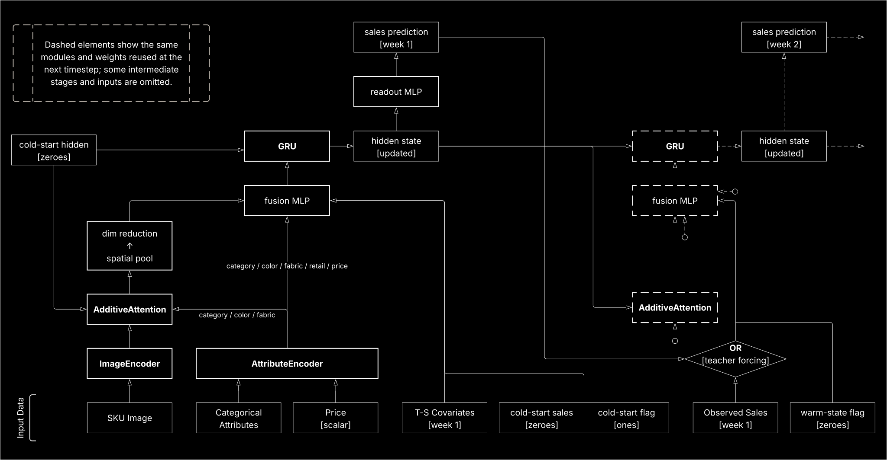

> [!NOTE]
> This repo is *exhibition* code: its purpose is to illuminate the reasoning that goes into how I make architectural decisions and to make it easier for you to assess my engineering ability. 
>
> Every line was written exclusively by me -- none of it was touched by Codex, but Codex did help me scrutinize it.

So, this repo implements a multimodal autoregressive forecasting model with attention (please see the architecture diagram [below](#the-model-at-a-glance)). It was shipped as part of the Farout Merchandiser [demo](https://tryfarout.com). For context, the demo's GPT layer reasons over (1) the user's practical market knowledge, (2) past and current retail data, and (3) the model’s sales forecasts to produce an action plan that optimizes inventory.

Below, I list the engineering virtues that I hope my code demonstrates, and I present them in the order that helps build an understanding of the system:

1. **Making complexity tractable.**

   

   Turning the forecasting logic into executable sequence machinery is not straightforward. Temporal relationships must survive every translation: from the forecast’s lag structure, to how the data is indexed, to teacher-forcing decisions, to what the GRU consumes and produces, and to the loop that drives this machinery.

   

   See [Jimmy.\_on_loop_mechanics\_](model.py#L798-L830), then follow the [rollout implementation](model.py#L629-L719).

   

   > **Tip:** The model is affectionately called `Jimmy`.

   

2. **Thinking from linear algebraic foundations.**

   

   **(A)** Let’s encode the image using a pretrained ResNet but improve its channel readout with channel attention. Okay, but why are we learning spatial preference patterns to arrive at channel attention? See how I reconcile this apparent contradiction in [AdditiveAttention.\_\_doc\_\_](model.py#L340-L389).

   

   **(B)** Are you passing the same representation to multiple downstream paths? Do you dim reduce once for all paths or separately for each? Does it matter? Affine dim reduction is a decision about representation semantics, not just tensor size. To decide where to reduce, I examine the relationship between semantics and the nullspaces of the reduction matrices in [Jimmy.\_on\_fusion\_out\_reduction\_](model.py#L855-L885).

   

3. **Catching unintended consequences.**

   

   **(A)** Watch how you apply dropout to sequences; standard `nn.Dropout()` samples a fresh mask on each decoder iteration. So the decoder must not only learn the temporal dynamics but also overcome the random, time-varying jitter of missing coordinates. To prevent this while preserving sample-level regularization, I built a custom [LockedDropout](model.py#L420-L457) module.

   

   **(B)** Don't forget to sever the unintended gradient paths created by the model auto-regressively consuming its own predictions; see [Jimmy.\_on\_detach\_](model.py#L833-L852).

   

4. **More engineering virtues:**

   

   - Handoff-oriented design: 
     (a) [One line to rule them all](train.py#L18-L41); 
     (b) [Checkpointing preprocessing state for eval](model.py#L486-L491);
   - Separation of concerns: [(a)](dataset.py#L126), [(b)](dataset.py#L297), and [deliberate violation](dataset.py#L331-L336);
   - [Patching insidious data leaks](dataset.py#L160-L166);
   - [Sound layer composition](model.py#L516-L546);
   - [Hardware-aware model sizing](model.py#L161-L171);
   - [Minimizing hardcoded assumptions](model.py#L274-L285);
   - [Cute broadcasting cascade](dataset.py#L466-L560);
   - [Auto-adaptive design for distinct real-world scenarios](config.py#L230-L276);
   - Verified determinism for reliable experimentation: [(a)](train.py#L62-L65) and [(b)](train.py#L94).

In all, this repo means to show that I respect craft and, hopefully, that I have the foundation to do world-class DL work at SSI.

---

[Help](config.py#L184-L355).

